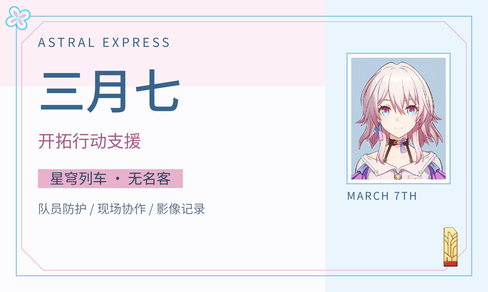
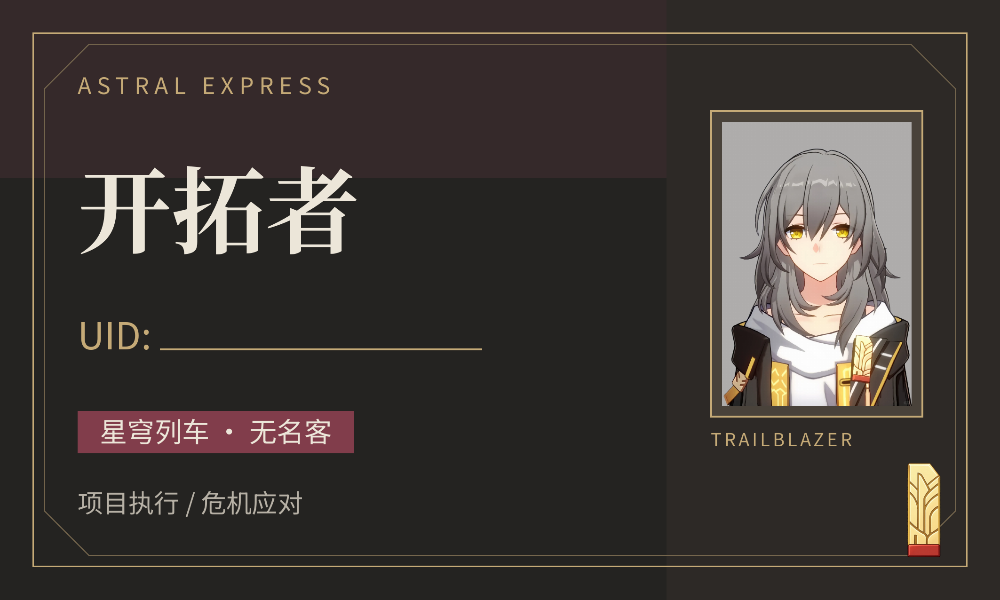
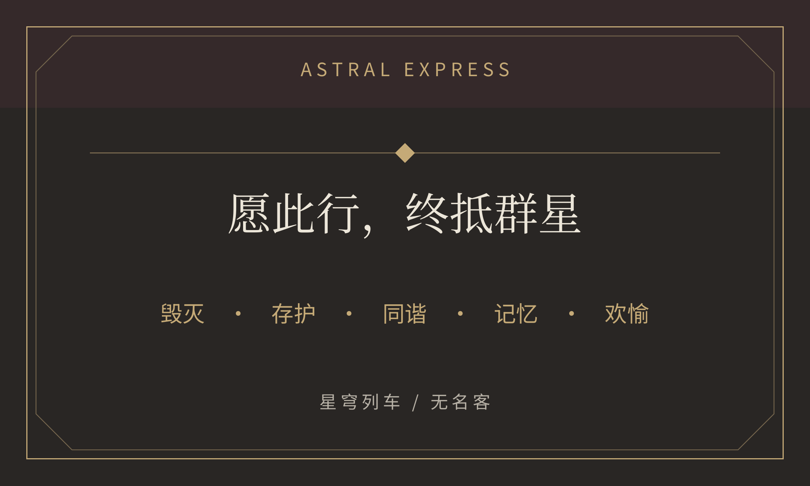

# 星穹列车角色名片

收录《崩坏：星穹铁道》三月七与开拓者的双面名片，包含可编辑 Typst 源码、角色素材、字体、双页 PDF 和 600 dpi 图片。

制作新角色或继续修改时，可使用[名片制作提示词与检查清单](PROMPT.md)，其中汇总了参考布局、角色差异、素材保真与双面交付要求。

成品尺寸均为 **90 × 54 mm**；PDF 第 1 页为正面，第 2 页为背面。三月七为蓝粉配色、不含 UID；开拓者为黑金配色，保留可填写的空白 UID 栏。

## 查看与下载

| 角色 | 双面 PDF | 正面 | 背面 | 编辑说明 | Typst 项目 |
| --- | --- | --- | --- | --- | --- |
| 三月七 | [下载](march7/output/pdf/march7-business-card.pdf) | [高清图](march7/output/images/march7-business-card-front-600dpi.png) | [高清图](march7/output/images/march7-business-card-back-600dpi.png) | [说明](march7/README.md) | [在线编辑](https://typst.app/project/pp2WfbmXR4VPtex18LQ64C) |
| 开拓者 | [下载](trailblazer/output/pdf/trailblazer-card.pdf) | [高清图](trailblazer/output/images/trailblazer-card-front-600dpi.png) | [高清图](trailblazer/output/images/trailblazer-card-back-600dpi.png) | [说明](trailblazer/README.md) | [在线编辑](https://typst.app/project/pYlUXr2Nfw6kLYnRrLrAPo) |

Typst 链接沿用项目现有访问权限。无访问权限时，可下载本仓库，将相应角色的源码、素材与字体上传到自己的 Typst 项目。

### 三月七




### 开拓者





## 编辑与构建

三月七的内容集中在 `march7/config/character.json`，主题在 `march7/config/theme.typ`，版式组件在 `march7/components/`。开拓者的内容与样式在 `trailblazer/main.typ`，开头的 `uid` 变量用于填写 UID。

安装 Python 依赖和 Poppler（用于图片渲染），在仓库根目录执行：

```sh
python3 -m venv .venv
source .venv/bin/activate
python -m pip install -r requirements.txt
python march7/scripts/build.py
python trailblazer/scripts/build.py
```

构建会验证每份名片为两页、每页尺寸为 90 × 54 mm，以及必要正文完整，再导出 PDF 和正反面 600 dpi PNG。也可使用 Typst CLI，详见各角色目录的编辑说明。

## 相关项目与素材

- 配套角色简历：[astral-express-resumes](https://github.com/mengmengjiang1999/astral-express-resumes)。
- 本仓库为非官方同人创作，角色、游戏素材及用户提供图片的权利属于原权利人；不以字体许可覆盖游戏素材。
- 随附 Noto 字体按 SIL OFL 许可分发，来源见 [字体说明](FONT-SOURCES.md)。
- PDF 为成品净尺寸，未加印刷出血或裁切标记；打印使用实际尺寸，正式双面印刷前检查套准。
